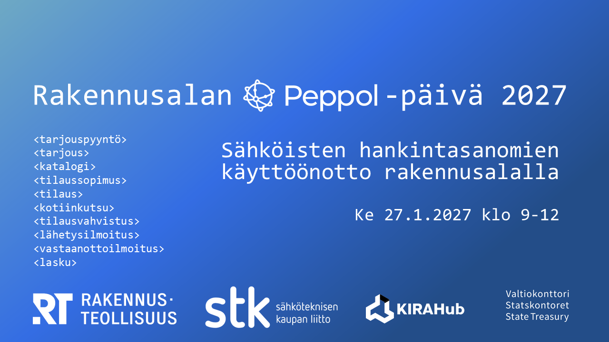

Tapahtuma ke 27.1.2027 klo 9–12. Järjestäjät: Rakennusteollisuus RT, Sähköteknisen kaupan liitto STK, KIRAHub ja Valtiokonttori. Ilmoittautuminen on avattu.

[Ilmoittaudu tapahtumaan](https://kirahub.typeform.com/to/YOvsiXrF)
